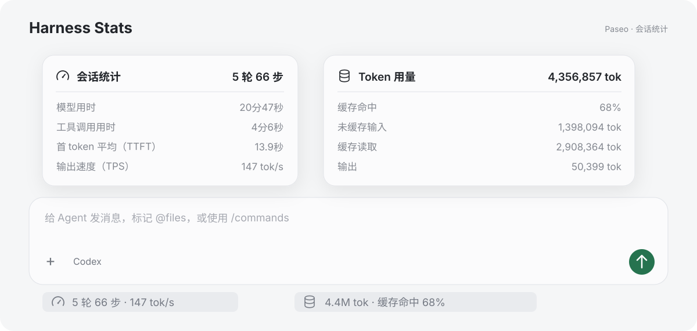

# Harness Stats

在 Paseo 输入框旁显示 DeepSeek Harness 风格的会话统计。



上图使用演示数据。

## 功能

- 常驻显示轮数、模型步数、输出速度、累计 Token 和缓存命中率。
- 点击左侧读数，在原位上方展开「会话统计」；点击右侧展开「Token 用量」。
- 保留 DSH 的标签与中文时长格式，如「模型用时」「首 token 平均（TTFT）」「20分47秒」。
- 支持悬停、展开选中态、再次点击收起、点击外部和 Esc 关闭。
- 跟随 Paseo 当前主题；状态行预留固定高度，切换会话复用缓存，不闪占位文字。
- 支持 Codex 和 Claude Code，已有会话历史也纳入累计。
- 设置入口位于 **设置 → 插件 → Harness Stats → 会话统计**，可开关统计、选择手机端位置。

不增加上下文圆环，继续使用 Paseo 自带的上下文显示。

## 安装

需要 Paseo **0.15.4 或更新版本**，并已开启插件。

```sh
paseo plugin install github:kogekiplay/paseo-harness-stats
```

更新：

```sh
paseo plugin update harness-stats
```

从本地源码安装：

```sh
git clone https://github.com/kogekiplay/paseo-harness-stats.git
cd paseo-harness-stats
npm ci
npm run typecheck
paseo plugin install "$PWD"
```

源码改动后使用 `paseo plugin reload harness-stats`，无需重启 daemon。

## 手机端

手机端显示两组实时读数，点击使用 Paseo 的原生浮层或底部面板。

**Paseo 0.15.4 原生客户端只提供输入框上方的插件位置。** 设置为「输入框下方」也不会绕过这个限制。仓库附带 [Paseo 底部插槽补丁](integrations/paseo/README.md)，供构建支持 `placement: "footer"` 的客户端。补丁通过按钮状态与作用域测试，完整客户端构建和真机验收尚未完成。

桌面端和网页版的输入框下方显示已可直接使用，不依赖该补丁。

## 统计口径

- **轮数 / 步数**：统计至少有一个带用量响应的会话轮次，步数按模型响应计数，不把工具调用数量当作模型步数。未报告用量的失败请求不计入。
- **Token 总量**：输入加输出。缓存读取、写入都属于输入，分别只计一次。
- **缓存命中**：缓存读取 Token ÷ 全部输入 Token。
- **模型用时与 TPS**：根据会话边界时间戳累计模型请求耗时；TPS 为可计时响应的输出 Token ÷ 模型耗时。时间戳允许时排除工具运行与用户等待时间，包含首字等待。
- **TTFT**：沿用 CC Switch 的会话日志思路。新版 Codex 使用响应中模型输出项的 `started_at_ms` 与请求边界；Claude Code 需要首块为思考，且带 `thinkingDurationMs`。只对条件满足的响应求平均，缺少样本显示 `—`。日志边界包含客户端准备时间，因此与路由层实时测量不完全相同。

子代理按各自会话独立统计。界面保持 DSH 风格，不显示附加说明或 `≈` 标记。

## 数据与兼容性

插件只读连接主机上的会话文件，并把聚合计数返回已连接的 Paseo 客户端，不修改会话、不请求外部统计服务。

- Codex：`CODEX_HOME` 或 `~/.codex` 下的 `sessions/`。
- Claude Code：`CLAUDE_CONFIG_DIR` 或 `~/.claude` 下的 `projects/`。
- 可见会话每两秒刷新；日志首次读取后只处理追加内容。
- 桌面页脚使用 DOM 适配。Paseo 更改输入框结构后，可能需要更新插件。

## 开发

```sh
npm ci
npm run typecheck
npm test
```

项目包含会话日志累计、TTFT、缓存、弹窗交互、主题切换、固定占位和工作区切换测试。GitHub Actions 会执行类型检查和测试。

## 致谢

界面参考 [DeepSeek Harness](https://github.com/deepseek-ai/deepseek-harness)，首字时间的日志推导参考 [CC Switch](https://github.com/farion1231/cc-switch)。运行于 [Paseo](https://github.com/getpaseo/paseo)。第三方许可见 [THIRD_PARTY_NOTICES.md](THIRD_PARTY_NOTICES.md)。
